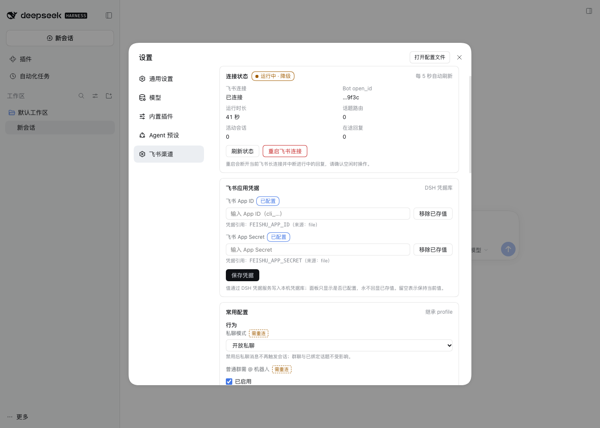
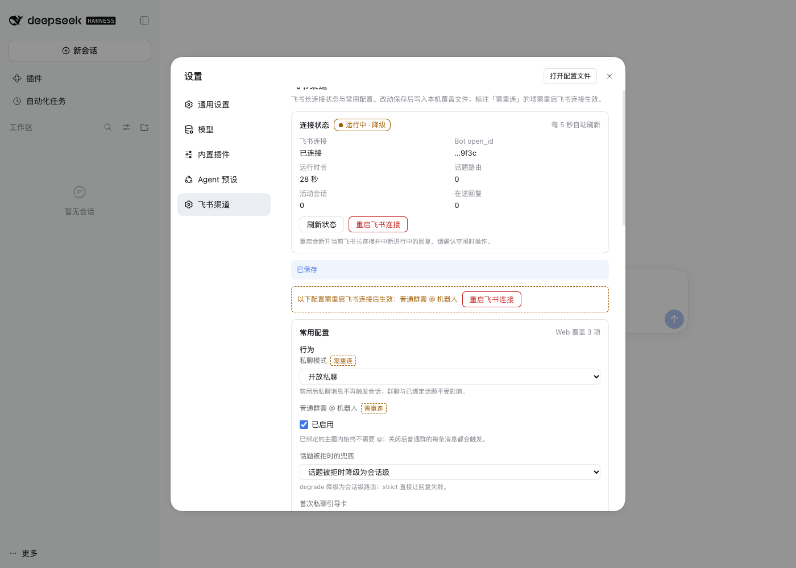

# dsh-channels

DeepSeek Harness（DSH）飞书渠道插件：**一个 dsh 实例对应一个飞书机器人**，用户只需与飞书机器人对话即可使用 dsh。

- 对话入口：私聊、群聊 @ 机器人、话题群 @ 机器人
- 收到触发消息：立刻加 **“Typing”** 表情 → 以话题形式回复（**创建话题**）→ 绑定 DSH session → 卡片 2.0 **流式回复** → 成功时更新为 **“DONE”**，失败时更新为 **“No”**
- 话题内后续消息**无需再 @**，自动延续该 session
- 工作区归属：私聊一人一工作区；群里**每个用户各自一个工作区**（同群不同用户互不影响）
- **HITL 审批**：当模型请求需要授权的动作（如 bash 沙箱升级 `sandbox_permissions`）时，插件监听主机 `approval/request` 事件，在同一话题里**新发一张独立审批决策卡**（✅ 允许 / ❌ 拒绝 按钮），用户点击后回填主机审批结果；超时（`approvalTimeoutMs`，默认 5 分钟）自动拒绝（fail-closed），非会话发起人点击无效
- **结构化提问**：模型调用 `ask_user_question` 时，插件监听主机 `user-questions/request` 瀑布并发一张问答卡（每个问题一组选项按钮，多选先勾选再「提交本题选择」），答案回填给模型；主机自带的应答者只有 Web 客户端，没有本插件时纯飞书会话会以 `NO_PROVIDER` 失败。超时（`questionTimeoutMs`，默认 5 分钟）或回合取消时本轮提问失败（fail-closed）；没有可选项的问题直接提示用文字作答，**阻塞期间普通文本回复即作为该问题的自由文本答案**（同时支持多选后的自定义文本）
- 全部基于飞书官方 SDK [`@larksuiteoapi/node-sdk`](https://www.npmjs.com/package/@larksuiteoapi/node-sdk)（WebSocket 长连接，免公网）
- **Web 设置面板**：Web/桌面端 **设置 → 飞书渠道** 查看连接状态、编辑常用配置（保存写入本机覆盖文件，部分字段需重启连接生效）；详见下文「Web 设置面板」章节

设计与可行性论证见 [docs/feasibility-and-design.md](docs/feasibility-and-design.md)。

## 斜杠命令

- `/help`：列出当前支持的斜杠命令，无需绑定 Session
- `/userid`：仅在私聊中直接回复当前用户 ID，无需绑定 Session，也不创建话题
- `/groupid`：仅在群聊中直接回复当前群组 ID，无需绑定 Session，也不创建话题；普通群聊遵循 `requireMention`，话题内无需重复 @
- `/health`：显示 Harness 与飞书通道健康状态，无需绑定 Session
- `/status`：显示当前 Session 状态与性能指标
- `/workspace`：显示当前 Session 工作目录
- `/effort`：查看当前 Session 推理强度；`/effort <档位-id>` 切换，`/effort reset` 恢复配置默认
- `/model`：查看当前模型与该 provider 的可用模型；`/model <模型-id>`（沿用当前 provider）、`/model <provider>/<model>` 切换，`/model reset` 恢复部署默认
- `/compact`：调用 Harness 原生命令压缩当前 Session 上下文
- `/renew`：在当前话题创建并绑定新 Session
- `/stop`：中断当前正在运行的回合（不冷恢复 Session；没有运行中的回合时明确提示）
- `/permissions`：查看当前 Session 的权限预设（沙箱 + 审批策略）与可选清单；仅在 `allowPermissionSwitch: true` 时支持 `/permissions <name>` 切换
- `/history`：显示当前话题的 Session 历史（含 `ctx.sessionQuery` 折叠出的会话标题与 live 标记）
- `/export`：导出当前 Session 的逻辑日志

`/new` 是 `/renew` 的别名。`/help` 由命令注册表按分组生成，新增命令只需在注册表里加一行。

## 流式卡片

卡片 2.0，三段式，默认 500ms 刷新（`refreshMs` 可调）：

1. **推理折叠面板**（`collapsible_panel`）：带边框、默认折叠；成功链路 **推理中 → 回复中 → 回复结束**，失败终态为 **回复失败**；右侧箭头随折叠状态翻转（折叠向下、展开向上，`icon_expanded_angle: 180`）
2. **活动状态两行**（小字，仅在存在临时活动时渲染，**互相独立、互不顶替**），让卡片在“模型不吐字”的阶段（工具执行、subagent、workflow）**不再静默**——按 `statusRefreshMs`（默认 5s）慢节奏刷新计时：
   - **状态行**（委托进度）：`tool-workflow/run-start / agent-start / agent-end / run-end`（工作流进度：完成数/总数、阶段、活动成员）→ run 结束转为 `🧵 工作流 xxx 结束（完成）` 并**保留到最终卡片**（后续工具调用、正文输出都不会顶掉它）；**子代理进度**（跨会话映射）：子代理是独立 session（`header.parentSession` 指向主会话），其 `subagent/descriptor`（label）、`tool/call`（当前工具）被折叠为 `🤖 子代理执行中：检索实现方案 (read) · 已运行 45s`，并行子代理显示计数，完成后在最终卡片汇总为 `🤖 子代理完成：a、b`。**只显示状态，不显示输出**——子代理正文是父模型的中间产物，绝不进卡片正文
   - **工具行**（父会话当前工具调用）：`tool/call` → `🔧 调用工具：bash · 已运行 Ns`（subagent 工具显示其 description、workflow 工具显示 meta.name），`tool/result` 返回即清除，**回复结束后随最终卡片收起**
   - 两者可同屏：如 `🧵 工作流 xxx 结束（完成）` + `🔧 调用工具：bash`
3. **回复正文**：富文本 markdown；超长正文**自动分段投放**——单卡片预算用满后按干净断点（段落 / 标题 / 代码块边界）切分，且**每张卡最多 5 个表格**（飞书硬限制，错误 11310），表格绝不会被从中间切断；续片以「📄 回复分段 n」卡片跟进同一话题，**全文无丢失**；续卡被飞书拒收时自动降级为纯文本消息（内容仍送达）
4. **session 信息**（两行小字）：
   - `🔑 {session id} · ⬆ input token {input} · ⬇ output token {output}`（session 累计口径）
   - `🧠 模型 {model}({effort}) · ⚡ 缓存命中 {cache} · 📊 上下文 {tokens}/{window}`（模型、推理强度、缓存命中按**当前轮次**；若本轮在请求头产生前失败则显示 `—`，不会沿用上一轮）

## Web 设置面板（设置 → 飞书渠道）

包内含可选的浏览器半区（`lib/client.js`，DSH client module）：在 Web/桌面端 **设置** 导航注册「飞书渠道」分区。宿主没有 `webServer` 服务（headless profile）时不加载面板，飞书通道本身不受影响。



> 截图为验证实例（mock 飞书通道、未登录账号）中的面板；「运行中 · 降级」来自该验证 profile 里其它仍在加载的插件 fiber，正常部署通常显示「运行中 · 健康」。

**连接状态**：健康徽标（健康 / 降级 / 异常）、飞书长连接状态、Bot open_id 尾号、运行时长、话题路由数 / 活动会话 / 在途回复、最近一次启动失败原因；每 5 秒自动刷新，也可手动刷新或**重启飞书连接**（会断开当前长连接并中断进行中的回复）。徽标不是健康时会额外显示「健康判定」原因——健康等级由宿主**所有 Cordis fiber** 折叠而来，因此「降级」也可能来自其它插件入口仍在等待依赖/加载（与飞书通道无关），原因行会列出对应插件名。

**飞书应用凭据**：在「飞书应用凭据」卡片里填写 **App ID / App Secret** 并保存，值经宿主 `ctx.credentials` 写入 DSH 凭据库（默认 `$DSH_HOME/.credentials.yaml` 的 `refs:` 段，仍遵循凭据层的解析优先级），面板只显示「已配置 / 未配置」与来源，**永不回显已存值**。保存时：通道运行中 → 提示重启飞书连接后生效；通道已停止（例如首次配置前启动失败）→ 自动重试连接，失败原因显示在状态卡。已存值可以单独「移除已存值」；卡片下方显示的是凭据**引用名**（profile 配置里的 `appId` / `appSecret`），换引用名仍需改 profile 配置。

**常用配置**：表单由 Host 下发的字段描述通用渲染，保存时用与 Loader 相同的 zod schema 校验，只提交改动过的字段：

| 分组 | 字段 | 生效方式 |
| --- | --- | --- |
| 行为 | `dmMode`、`requireMention` | 需重启连接 |
| 行为 | `threadFallback`、`welcomeOnboarding`、`allowPermissionSwitch` | 立即生效 |
| 内容与图片 | `acceptImages`、`maxImagesPerMessage` | 立即生效 |
| 模型 | `provider`、`model`、`reasoningEffort`、`agentPreset` | 立即生效（后续回合/新会话使用） |
| 流式卡片 | `refreshMs`、`statusRefreshMs`、`loggerLevel` | 需重启连接 |

保存只改动了「需重连」字段时，面板会列出待生效项并提供一键重连：



**配置层级**：`configSchema` 默认值 < profile `cordis.patch.yml` 的 `config` < Web 面板覆盖。面板只把可编辑字段写入 `$DSH_HOME/dsh-channels/settings.json`（可用配置项 `settingsFile` 改路径）；「清除 Web 覆盖」删除该文件并回落到 profile 配置。`baseDir`、超时、路由 TTL 等只读展示；凭据**值**在「飞书应用凭据」卡片编辑，凭据**引用名**（`appId` / `appSecret` 配置项）仍由 profile 配置决定。

**为什么落在插件自己的文件而不是 profile 的 `cordis.patch.yml`？** DSH 提供官方 `ctx.configEditor.edit()`，可以安全写 profile patch（完整 Config 校验、保留注释与 `!!js`、原子替换、失败回滚、与 HMR 串行）；但它是「完整配置编辑」通道——本插件的 Config 是 zod，没有 schemastery `.volatile()` 标记，普通字段写入会触发 Loader 重载插件，等于每次保存都断开并重连飞书；而且该服务只在有 `profileContext` 的启动器（桌面端 / `dsh web`）存在。`$DSH_HOME/<plugin>/` 是 DSH 插件保存运行时数据的惯例（如 dsh-pet 的 `$DSH_HOME/dsh-pet/`），因此面板偏好写入 `$DSH_HOME/dsh-channels/settings.json`：保存即生效（需重连字段除外）、可一键清除回退、不依赖 `profileContext`；profile 的 `cordis.patch.yml` 继续作为部署级基础配置层。若将来要求「所有配置统一进 profile」，迁移路径是改用 `ctx.configEditor.edit()` 并接受保存触发插件重载。

**安全边界**：面板路由与其他本机 DSH 路由一样**不带鉴权**；写操作（PUT / DELETE / POST）额外校验 `Origin` 与 `Host` 同源，拒绝跨站页面改写配置或凭据。凭据值只走写路径、响应永不回显，也不会写进 Web 覆盖文件。不要把 DSH Web 服务绑定到不可信网络。

**构建**：DSH 只加载已构建的浏览器 bundle，改了 `src/client/` 或 `src/settings/contract.ts` 后需要重新构建并重启应用：

```bash
pnpm build            # 产出 lib/index.js（Host 入口）与 lib/client.js（浏览器半区）
pnpm verify:host      # 以纯 ESM 导入 Host bundle，检查 Cordis 插件面
pnpm verify:client    # 用 __ModuleLoader__ shim 做 loader 冒烟
```

## 目录结构

```
src/
├── index.ts               # 插件入口 apply(ctx)：effect + 导出 barrel
├── config.ts              # 配置 schema 与凭据引用校验
├── service.ts             # FeishuService 门面：生命周期、事件接线、入站与命令编排
├── dsh-types.ts           # 宿主类型桥 barrel → src/host/
├── host/                  # DSH 表面（纯类型，无运行时依赖）
│   ├── core.ts            #   身份 / LLM 消息与流 / Session 日志与事件
│   ├── agent.ts           #   Agent、注册表、agent preset
│   ├── commands.ts        #   ctx.commands 表面
│   ├── interaction.ts     #   approval/request + user-questions/request
│   └── services.ts        #   工作区 / 存储域 / 凭据 / token / llm / 投影 / HostContext
├── cards.ts               # 卡片 barrel → src/cards/
├── cards/                 # 卡片 2.0 JSON 渲染
│   ├── primitives.ts      #   信封、markdown、按钮、分栏等原语
│   ├── streaming.ts       #   流式回复卡、分段、字节/表格预算
│   ├── approval.ts        #   审批决策卡
│   └── question.ts        #   结构化问答卡
├── approvals.ts           # 审批 barrel → src/interactions/
├── questions.ts           # 问答 barrel → src/interactions/
├── interactions/          # HITL 交互
│   ├── pending.ts         #   待决卡共享生命周期（登记/送达/门禁/超时/settle-once）
│   ├── approvals.ts       #   审批应答器
│   └── questions.ts       #   结构化提问应答器
├── session/               # 会话侧基础设施
│   ├── routes.ts          #   路由存储 + TTL 墓碑
│   ├── repair.ts          #   inflight 快照 + 重启修复
│   ├── manager.ts         #   live Agent、冷恢复、preset、/renew 事务
│   └── request-policy.ts  #   会话级 provider/model/reasoningEffort 覆盖（/model、/effort）
├── feishu/
│   ├── delivery.ts        # 出站投递：首帧话题卡、结果卡、分段降级、表情生命周期
│   └── inbound-image.ts   # 入站图片：资源下载 → attachment → ImageBlock（失败降级）
├── routing/
│   └── inbound.ts         # 入站路由：去重、准入、路由决策树、建/续会话、首触引导
├── commands.ts            # 斜杠命令解析、agent 作用域注册与结果卡
├── commands/registry.ts   # 命令注册表：词表 / 准入规则 / 分组 help 的单一事实来源
├── session-commands.ts    # /status /workspace /renew /history /compact 渲染
├── stats.ts               # 宿主投影优先的 token / 缓存 / 上下文折叠
├── domain.ts              # storageDomain 域声明与路由记录 schema
├── health.ts              # 健康快照与卡片
├── session-export.ts      # 逻辑日志导出
├── feishu-channel.ts      # 官方 SDK Channel 适配（可注入 stub）
├── client/                # 浏览器半区：设置 →「飞书渠道」页面（构建到 lib/client.js）
│   ├── index.ts           #   client 插件入口：settings.section 注册 + 样式
│   ├── panel.tsx          #   状态卡 + 通用配置表单 + 只读信息
│   ├── api.ts             #   同源 /dsh-channels/* 请求封装
│   └── styles.ts          #   语义 token 样式（注入一次）
├── settings/              # Web 设置面板 Host 半区
│   ├── contract.ts        #   双端共享 wire 类型 / 字段清单 / 路由常量
│   ├── overlay.ts         #   settings.json 读写、校验、合并
│   ├── surface.ts         #   状态 / 面板视图模型 + 保存 / 清除 / 重连
│   └── routes.ts          #   HTTP 路由 + 同源写保护
└── workspaces.ts          # (chat, user) → 工作区目录
```

`lib/index.js` 与 `lib/client.js` 是构建产物（`pnpm build`）：前者是安装后 profile 直接加载的 Host 入口（普通 ESM，不依赖 TypeScript 运行时转换），后者是设置面板的浏览器 bundle。`scripts/verify-host-loader.mjs` / `scripts/verify-client-loader.mjs` 分别做冒烟。

## 接入 DSH

插件安装进 dsh 的 **profile**（`$DSH_HOME/profiles/<name>/`，未设置 `DSH_HOME` 时默认 `~/.dsh`），web 界面即 `web` profile。已在真实 dsh 上实测通过的完整流程见 [docs/feishu-onboarding.md](docs/feishu-onboarding.md)（含飞书控制台配置、逐通道联调清单与故障排查），这里给出最小步骤：

```bash
# 在 deepseek-harness 仓库内：把本地 checkout 链接进 web profile
DSH_HOME=$DSH_HOME pnpm dsh plugin --profile web add link:/path/to/dsh_channels
```

安装前先构建：在插件仓库执行 `pnpm build`——Host 入口是 `lib/index.js`（profile 直接以 ESM 加载，不经过 TypeScript strip；`package.json` 的 `main` 指向它），设置面板是 `lib/client.js`。构建后重启 dsh（桌面端重启应用，`dsh web` 重启服务并刷新页面）。DSH 只加载已构建产物，直接改 `src/` 不会生效；没有 web 载体的 profile 不注册面板，飞书通道照常运行。

包内的 `cordis.patch.yml` 会自动把 `dsh-channels` 加入 Loader；profile 只需在 `$DSH_HOME/profiles/web/cordis.patch.yml` 中按稳定 id 提供该实例的配置：

```yaml
- id: dsh-channels
  config:
    appId: 'FEISHU_APP_ID'              # 凭据引用名（非密钥本身），经 ctx.credentials 解析
    appSecret: 'FEISHU_APP_SECRET'
    baseDir: './channels-data'          # 工作区根目录（按 私聊/群聊/用户 组织）
    provider: 'deepseek-official'       # 可选：省略则用部署默认
    model: 'deepseek-v4-flash'          # 可选
    reasoningEffort: 'high'             # 可选：模型声明的精确档位 id；省略则用适配器/provider 默认
    agentPreset: 'standard'             # 可选：省略则挂 roster 默认 preset（web profile 下工具只在 preset 里）
    refreshMs: 500                      # 卡片刷新频率
    statusRefreshMs: 5000               # 活动状态行保活间隔（工具/子代理/工作流等待期的计时刷新）
    requireMention: true                # 普通群需 @ 机器人
    dmMode: 'open'
    threadFallback: 'degrade'           # 话题被拒时降级为会话级路由
    routeTtlMs: 2592000000              # 话题路由 30 天无活动即过期；后续消息明确拒绝，不新建 Session（0 = 关闭）
    approvalTimeoutMs: 300000           # HITL 审批决策卡等待时长（默认 5 分钟；超时自动拒绝）
    questionTimeoutMs: 300000           # ask_user_question 问答卡等待时长（默认 5 分钟；超时本轮提问失败）
    acceptImages: true                  # 转发飞书图片给模型（需主机 attachments 服务）
    maxImagesPerMessage: 4              # 单条消息最多转发几张图（其余忽略，文字说明仍保留）
    welcomeOnboarding: true             # 私聊首次触达发一张引导卡（按 chat 持久化去重）
    allowPermissionSwitch: false        # 是否允许 /permissions <name> 从飞书侧切换权限预设（安全敏感）
    loggerLevel: 'info'
    # settingsFile: '/custom/path/settings.json'  # 可选：Web 面板覆盖文件路径（默认 $DSH_HOME/dsh-channels/settings.json）
```

`reasoningEffort` 是每个 Session 的初始/重置默认值，并在新建、恢复或借用 Agent 的作用域内以 `prepend` 外层覆盖 `agent/request`，因此胜过已存在的模型选择与 provider 默认；借用外部 Agent 时，插件关闭只移除这条频道策略，不销毁外部 Agent。话题所有者可用 `/effort <档位-id>` 覆盖当前 Session，`/effort` 查看生效来源，`/effort reset` 恢复该配置值（未配置时恢复模型适配器/provider 默认）。成功选择由 Session 自带的 `command/run` / `command/done` 日志恢复，重启后仍生效；新建 Session 不继承旧 Session 的覆盖。

推理档位是适配器拥有的不透明 id（常见如 `off`、`low`、`high`、`max`），命令不会猜测或预校验 provider 的能力；不受支持的值会在下一次模型请求前被 Harness 拒绝，并按失败终态显示错误。

从旧版手写 Loader 行迁移时，删除原来的 `insert` / `id: channels` 条目；不要让旧行与 bundle 提供的 `id: dsh-channels` 同时存在，否则会启动两个插件实例。

**凭据**放在 `$DSH_HOME/.credentials.yaml`（dsh 受管凭据库，热加载，与 `DEEPSEEK_API_KEY` 同库）：

```yaml
FEISHU_APP_ID: cli_xxxxxxxx
FEISHU_APP_SECRET: xxxxxxxx
```

也可以不手改文件：安装并在 Web 面板里打开 **设置 → 飞书渠道**，在「飞书应用凭据」卡片填入 App ID / App Secret 保存即可（值同样写进该凭据库）。

文件必须仅属主可读（dsh 强制校验，否则拒绝启动）：`chmod 600 $DSH_HOME/.credentials.yaml`。解析优先级：进程环境变量 > `.credentials.yaml` > `<cwd>/.env` > `$DSH_HOME/.env`（由 `dsh-credentials-local` 提供，热加载）。配置里只写引用名，明文密钥会被 schema 拒绝。凭据改动后重启 dsh 生效。

验证组合（不启动服务）：`DSH_HOME=$DSH_HOME pnpm dsh web --dump-config | grep dsh-channels`

启动成功标志（控制台）：`[dsh-channels] feishu long connection established, bot open_id: ou_xxx`

宿主 profile 已内置所需服务（agent-loop、llm-deepseek、session 持久化、storage-domain、workspace）；推荐确认 `dsh-token-meter` 已启用（卡片上下文占用显示）。

**工具与 agent preset（web profile）**：web profile 把 bash/fs/todo 等工具行全部标为 `disabled: true`，工具只存在于 agent preset 里，且 `agents.create()` 不会自动应用 preset——插件因此在创建/恢复会话时通过 `setup` 回调挂载 preset（默认 `standard`，可用 `agentPreset` 指定更精简的 preset，如只含 bash/fs 的自定义项），并把 preset id 记录进会话头。若机器人回复把 `<tool_calls>…` 当纯文本吐出，即该会话没挂上 preset；修好后再看会话的 `request/header` 应带 `tools` 字段、日志出现 `tool/call` 事件。无 preset roster 的部署（如 headless）不做此步骤，工具本就位于宿主层。

## 飞书侧准备

1. [飞书开放平台](https://open.feishu.cn/app) 创建**企业自建应用**，开启**机器人**能力。
2. 权限（至少）：
   - `im:message`（获取与发送单聊、群组消息）
   - `im:message.p2p_msg:readonly`（读取用户发给机器人的单聊消息）
   - 事件：**接收消息 im.message.receive_v1**（含“接收群聊中 @ 机器人消息”）
   - 回调：**卡片回传交互 card.action.trigger**（HITL 审批 / `ask_user_question` 问答按钮的回传事件，同样走长连接）
   - `im:message.reactions:write_only`（发送、删除消息表情回复）
   - `im:message:update`（更新卡片）
3. 事件订阅方式选**长连接**（WebSocket，免公网）。
4. 发布版本并把用户加入可用范围；将机器人拉入测试群。

## 行为与降级

- **图片输入**：飞书图片（`message.resources` 中的 `image`）经通道下载 → 主机 `attachments.saveImages()` 落盘 → 作为 `ImageBlock` 进入模型消息；任何一步失败都只丢这张图，文字说明照常送达。`ctx.attachments` 未挂载或 `acceptImages: false` 时退化为纯文本。
- **DSH 0.2.0 兼容**：会话日志读取改用 `Session.snapshotEvents()`（整段 `Session.events` getter 已被 DSH 删除）；正文/推理增量改用瞬时事件 `agent/assistant-stream`（持久化 `assistant/chunk` 已不再产生，改为把流内嵌进 `assistant/message.stream`），并处理 `abandoned` 尝试的文本回滚；卡片 token / 缓存命中 / 上下文窗口优先读宿主 `sessionProjections`（`sessionStats` / `tokenUsage` / `contextPressure`），未挂载时回退到本地增量折叠 + `llm.resolveModelInfo`。完整评估、证据与实施状态见 [docs/review-dsh-0.2.0.md](docs/review-dsh-0.2.0.md)。
- **话题创建**：通过回复消息接口 `reply_in_thread: true`（官方文档明示的“以话题方式回复（即创建话题）”）。响应后经 `im.v1.message.get` 取回 `thread_id` 写入路由表。
- **话题延续**：`im.message.receive_v1` 事件自带 `thread_id`，命中路由表即 `agent.followup()`，无需 @。同一 (chat, user) 的**并发首消息会被串行化**：后到的消息等待在途的会话建立完成，再按串行语义续聊同一 session 或另起新话题——不会重复建 session、覆盖路由，也不会落入“无路由、无 @”的丢弃窗口。
- **降级（`threadFallback: 'degrade'`）**：私聊或群聊拒绝话题回复（如 230071）时，自动改为普通回复，路由键退化为 `chat:p2p:<chat_id>:<open_id>` / `chat:group:<chat_id>:<open_id>`（会话级延续）；`strict` 则直接失败。
- **重启恢复**：路由表持久化在 `storageDomain`；消息到达时 `ctx.agents.resume()` 懒恢复 session。若会话已被其他 owner 恢复为 live（如 Web UI 打开过该会话、并发冷恢复竞态），插件**借用**该 live agent 直接 `followup()`，不再报 "cannot prepare session … while it is live"。借用的 agent 不归插件 dispose；shutdown 与在途 resume 竞态时，刚发布的 agent 会被立即 dispose 以避免泄漏进下一实例的 live 注册表。
- **重启修复（流式中断）**：每条正在流式的 turn 会把自己的修复凭据（trigger 消息、Typing reaction id、全部段卡 id）写入 `channels_routes` 域的 `inflight` 表（键 = 主卡 message id，turn 结束即删）。重启后长连接一建立，插件就把上一实例留下的中途卡片 patch 成「⚠️ 服务已重启，本次回复中断，请重新发送消息。」终态并补 DONE 表情；patch 失败重试一次（上限 2 次）后放弃。持久化盘点与缺口清单见 [docs/persistence.md](docs/persistence.md)。
- **消息去重（WS 重投幂等）**：飞书长连接重连会重投未 ack 的事件；每条消息在任何副作用之前先落一条 `processed` 记录（键 = message id，飞书全局唯一），重投消息被直接丢弃——同进程靠内存守卫、跨重启靠持久化记录，每条消息至多处理一次。记录保留 24 小时后由 GC 清扫。
- **路由表 GC 与过期话题拒绝**：超过 `routeTtlMs`（默认 30 天）无活动的真实话题路由会先写入最小持久化墓碑，再删除活动路由；此后该话题中的普通消息和 Session 命令会收到「话题已过期」提示，插件不会恢复旧 Session，也不会在可见历史仍属于旧 Session 的话题里新建 Session（`/help`、`/userid`、`/groupid`、`/health` 仍可用）。墓碑跨重启保留，仅含 thread/chat/owner/过期时间；旧 DSH Session、日志和工作区文件不删除。降级的 chat-scoped 路由没有独立话题边界，仍直接清理。陈年 in-flight 快照同时在启动时及每 6 小时清扫。`routeTtlMs: 0` 关闭后续路由过期处理，已产生的墓碑仍保持拒绝语义。
- **HITL 审批**：插件以 `prepend: true` 注册为宿主 `approval/request` 瀑布的应答者——本频道路由的 session 的审批请求**优先于** Web 网关的通用应答（其面板对飞书用户不可见），非本频道的请求原样 `next()` 交给其他应答者。审批卡是**独立消息**（锚定到该 session 最新流式卡、同话题），绝不嵌入流式卡（其全量替换 patch 会冲掉按钮）。待审批时允许/拒绝按钮以两列等宽方式排列在同一行；决策仅在会话发起人点击时生效：允许 → `allowed-once`、拒绝 → `rejected`、超时 → `rejected`（fail-closed，卡面显示「已超时」）、请求被撤回（abort）→ `cancelled`、卡片发送失败 → `unavailable`（fail-closed）；每次决策后卡片更新为终态并移除两个按钮。审批记录（`approval/asked`/`decided`）由宿主会话日志负责，插件不做持久化——重启后遗留问题随 turn 消亡，与 Web 网关一致。需要飞书应用订阅 **card.action.trigger** 回调（见「飞书侧准备」）；启动日志 `HITL 审批应答已就绪` 表示生效，`主机未挂载 approval 服务` 表示该部署未启用 HITL。
- **终态与表情**：成功轮显示「回复结束」并把 `Typing` 换成 `DONE`；`turn/end.kind = error` 时显示「回复失败」，正文附带结构化错误消息与错误码，并把 `Typing` 换成 `No`。模型/推理强度/本轮缓存样本不会继承上一轮。
- **限频**：卡片更新单条消息 5 QPS、应用级 1000 次/分钟；500ms（2 QPS）默认安全，`refreshMs` 下限 200ms；活动状态行的保活心跳默认 5s（`statusRefreshMs` 下限 1s），远低于限频。
- **卡片体积**：单卡片 JSON 目标 ≤ 28 KB（飞书上限 30 KB，留 2 KB 冗余）；正文超长自动分段为多张续卡（按段落/标题/代码块边界切分，每卡 ≤ 5 个表格，全文保留）。推理面板另有独立的 **5 KB 上限**（`REASONING_MAX_BYTES`，含截断标记；约 1.65 K 中文字 / 4.96 K ASCII 字），不占用也不被正文挤占——窗口长度与正文长短无关，超出部分保留头部并追加「…（内容过长，已截断）」。
- **续卡降级**：分段卡片发送被飞书拒绝（如表格数量超限 230099/11310）时，自动改发纯文本消息；卡片更新失败按指数退避重试，不刷屏报错。

## 已知取舍（v1）

- patch 为全量替换：流式期间用户手动展开折叠面板会被下一次刷新收起；流式结束后不再刷新，可自由展开。
- 超长正文拆成多张卡片（分段投放）：推理内容不跨卡片，始终留在首卡；超出 5 KB 的部分被截断（只保留开头），不追加投放。
- 子代理只显示状态（label / 当前工具 / 计时 / 并行计数），不显示其输出正文；后台子代理（`run_in_background`）在父 turn 结束后不再继续显示进度（卡片随父 turn 收尾）。
- 私聊 `reply_in_thread` 需真机验证（文档未明示限制，失败走降级路径，见上文）。
- 会话的 agent 常驻内存，不做空闲回收（重启后按需懒恢复）。
- 重启修复会**全量替换**中断的卡片：旧进程里已流出的部分正文随之消失（本地没有副本，patch 是全量语义）；修复是一次性 + 一次重试，不再无限重试。
- 路由 GC 是 TTL 兜底：未监听飞书“群解散/话题删除”事件做主动清理；真实话题过期后写入持久化墓碑，用户回来会收到明确拒绝，不会在旧话题中误建新 Session。
- 消息去重是**至多一次**语义：接受后、副作用完成前崩溃的极小窗口内，重投消息会被丢弃——中断修复卡提示“请重新发送消息”，用户重发即可（新 message id 正常处理）。
- Web 面板编辑的是当前凭据**引用名**背后的值（profile 配置 `appId` / `appSecret` 指向的 ref）；更换引用名仍需编辑 profile 配置并重启 DSH。凭据提供方只读时面板会禁用输入并提示。
- Web 面板的模型字段是自由文本（无 provider/model 下拉目录），填错会在下一次模型请求时由 Host 按现有链路报错；「重启飞书连接」会中断进行中的回复。
- 持久化盘点与全部缺口状态见 [docs/persistence.md](docs/persistence.md)。

## 开发

```bash
pnpm install --store-dir ./.pnpm-store   # 受限环境；正常环境直接 pnpm install
pnpm typecheck        # Host（tsconfig.json）+ Client（tsconfig.client.json）两套
pnpm test
pnpm build            # → lib/index.js（Host）+ lib/client.js（浏览器半区）
pnpm verify:host      # Host bundle 以纯 ESM 导入加载
pnpm verify:client    # client loader 冒烟
pnpm check            # 以上全部
```

测试以 stub 替换官方 SDK 与 DSH 宿主服务，无需真实凭据。`tests/settings.test.ts` 覆盖：覆盖层 schema/层级、面板视图模型、HTTP 路由（含同源写保护）、`apply()` 的 webServer 接线，以及 `FeishuService` 的覆盖加载 / 热更新 / 重启 / 启动失败记录。
